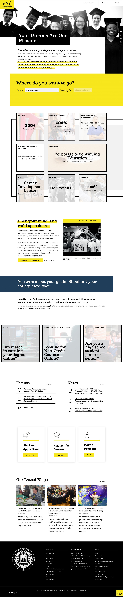
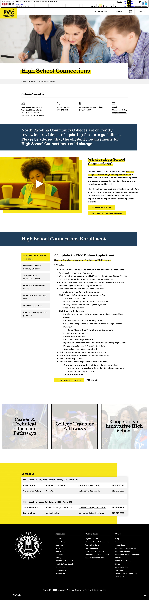

# Fayetteville Technical Community College: WordPress Site

This is a custom WordPress theme and site build for Fayetteville Technical Community College (FTCC), one of the largest community colleges in North Carolina. I built it at **Walk West** in Raleigh, NC. The site serves current and prospective students, military and veteran learners, high school dual-enrollment students and the wider community.

The site was built for many campus departments to manage their own content. A central moderation system gives each section of the site its own roles and permissions. Editors create and update pages as drafts, which then go through review and are passed to the right people for approval and publishing.

| Homepage | Interior page: High School Connections |
|:---:|:---:|
|  |  |

---

## Highlights

### "Where do you want to go?" persona filter
The homepage leads with a two-step guided search that reads as a sentence: **"I am a [Veteran] looking for [Career Transition]."** Each audience (active-duty military, reservist, veteran, current high school student and others) has its own set of goals, and each goal routes to a dedicated landing page.

- The persona-to-page map lives in PHP (`functions/personas.php`). A custom REST endpoint, **`/wp-json/personas/v1/all`**, exposes it.
- On the front end, JavaScript fetches the map, fills the second `<select>` based on the first choice, and keeps the submit button disabled until both choices are made.
- The choice is also sent to `admin-ajax.php`, so the site can remember the visitor's audience.

### Flexible "panel" page builder
Editors build pages from **20+ reusable panels**. These are ACF Pro flexible content layouts, each rendered by its own template in `template-parts/panels/`. The layouts are versioned in the repo as ACF JSON (`acf-json/`).

> 2/3 column · tile grids and tile sliders · double callouts · tabbed content · media + content · full-width images · tables · office contact info · success stories · news, events, sports and blog feed teasers · Twitter and Instagram feeds · logo lists · anchor links · **Military Credit Transfer Tool** · **Persona Filter**

### Accessible, keyboard-friendly navigation
- Drop-down menus work from the keyboard: submenus open on focus, and a short delay keeps them open while focus moves into them.
- Tabbed content uses an accessible tab panel pattern with smooth scrolling to anchor links.
- Panels are labeled regions (`aria-label`) and form fields have explicit `<label>`s.
- A "smart menu" remembers which audience menu a visitor last used (cookie-based), so returning visitors see the menu that applies to them.

### Content types and integrations
- A **News** post type with a **Sport** taxonomy for the Trojans athletics news feed
- **The Events Calendar**, with theme overrides in `tribe-events/`
- **Gravity Forms**, including Stripe payments and PDF output, for applications and intake forms
- **Relevanssi** and **Solr Power** for site search, and **Yoast SEO Premium** for SEO
- Editorial workflow with **Edit Flow** and **Oasis Workflow** for a large group of campus content editors
- Shortcodes for editors: `[button]`, `[highlight]`, `[ultra]` and `[ccwidget]`

---

## Front-end architecture

The theme is `wp-content/themes/wwframework`, built on the Walk West Framework starter theme.

| | |
|---|---|
| **Templates** | PHP templates with logic kept separate from markup. Shared helpers are in `functions/`, reusable markup is in `template-parts/`, and each panel has its own template. |
| **Styles** | Mobile-first Sass in a 7-1-style structure (`abstractions/`, `base/`, `components/`, `layout/`, `overrides/`, `variables/`). Breakpoints use [Breakpoint Sass](http://breakpoint-sass.com/), z-index uses a tier map, and Sass Lint enforces style rules. |
| **JavaScript** | jQuery modules in `js/ww-functions.js`: mobile navigation, a header that hides on scroll, keyboard-accessible menus, tabs, equal-height components, Slick slideshows and the persona filter. |
| **Build** | Gulp: Sass compilation with globbing, sourcemaps, Autoprefixer, Sass/JS/PHP linting, image optimization (imagemin and Guetzli), LiveReload, and Bower for front-end libraries. |

```
wp-content/themes/wwframework/
├── acf-json/            ACF field groups (version-controlled)
├── functions/           init, post types, shortcodes, widgets, personas REST endpoint
├── template-parts/
│   └── panels/          one template per flexible-content panel
├── tribe-events/        The Events Calendar template overrides
├── sass/                mobile-first Sass source
├── js/ww-functions.js   front-end behaviour
├── libs/                Bower libraries (jQuery, Fancybox, Breakpoint, Modernizr)
└── gulpfile.js          build pipeline
```

---

## Local development

**Requirements:** PHP 7.2, MySQL, Node.js with an older Gulp 3 toolchain, and Bower.

1. Clone the repo into your local web root. In `wp-config-local.php`, set the database name, user, password and site URL. That file is only loaded outside Pantheon.
2. Import a database snapshot from Pantheon and run a search-replace on the site URL.
3. Build the theme:

   ```bash
   cd wp-content/themes/wwframework
   npm install
   gulp bower-install
   gulp             # compile Sass, lint and watch
   ```

## Deployment

The site runs on **Pantheon** (`pantheon.yml`, PHP 7.2). Code moves from Dev to Test to Live through Pantheon's Git-based workflow. File modifications are turned off on Test and Live.

---

*Screenshots were captured from the live site in 2018–2019.*
